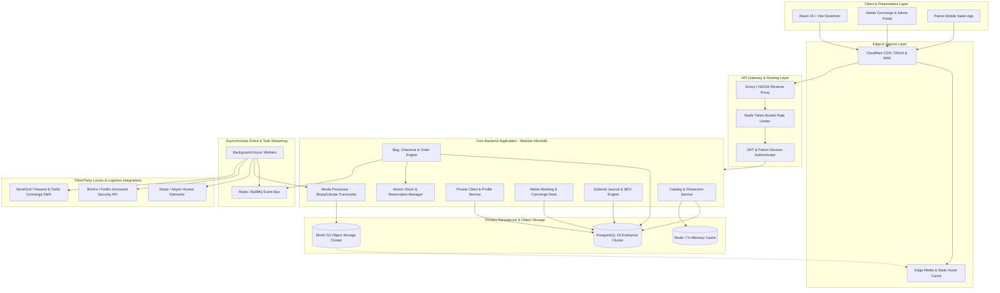
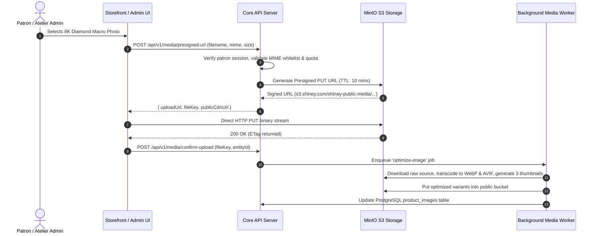
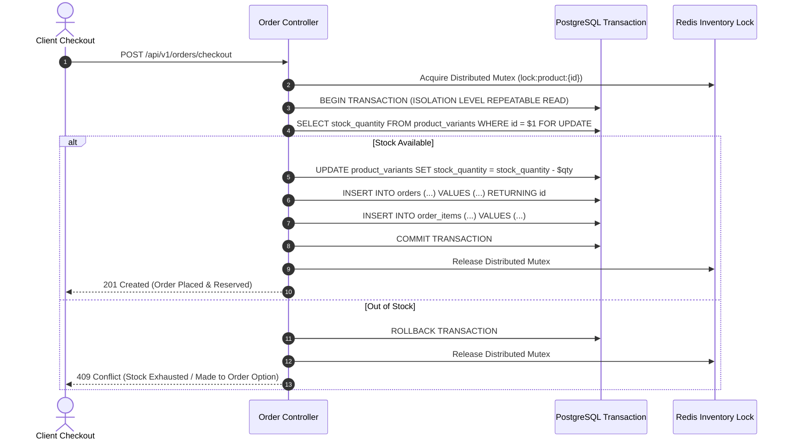

# Shiney Haute Joaillerie — Backend System Architecture Specification
**Document Version:** 1.0.0  
**Architecture Classification:** Modular Monolith (Cloud-Native & Microservices-Ready)  
**Primary Database:** PostgreSQL 16+ (ACID Relational Core)  
**Primary Object Store:** MinIO (High-Performance Distributed S3-Compatible Media & Document Store)  
**Cache & Fast State:** Redis 7 (Cart Sessions, Fast Lookups, Distributed Locks)

---

## 1. Executive Architecture Overview

Shiney Haute Joaillerie requires an enterprise-grade backend infrastructure capable of delivering millisecond-grade performance for ultra-high-resolution luxury jewellery assets, zero-drift transactional integrity for high-value orders (ranging from $500 to $50,000+), armored courier logistics tracking, and private atelier concierge workflows.

### Architectural Core Principles
1. **Strict Transactional Soundness (PostgreSQL)**: Financial ledgers, stock reservations, orders, and certificates use ACID transactions with row-level locks (`SELECT FOR UPDATE`) to prevent double-selling of one-of-a-kind bespoke creations.
2. **Offloaded Object Storage (MinIO S3)**: High-resolution zoom imagery (8K macro photography), lost-wax casting 3D CAD models, GIA grading certificates (PDFs), and private client uploads are strictly stored in MinIO buckets and served via CDN caching or short-lived presigned URLs.
3. **Decoupled Asynchronous Processing**: Media watermarking/optimization, automated PDF certificate generation, armored courier webhooks, and transactional emails/SMS are dispatched to background worker queues.
4. **Zero-Trust Security & PCI Compliance**: Client financial data is tokenized via Stripe/Adyen hosted fields; sensitive client records (e.g. bespoke ring engravings, high-net-worth home addresses) are encrypted at rest with AES-256.

---

## 2. Multi-Tier System Architecture Diagram

---

## 3. MinIO S3 Object Storage Topology

MinIO provides high-throughput, private, and public object storage natively compatible with AWS S3 APIs.

### Bucket Matrix & Access Control Policy

| Bucket Name | Access Classification | Max File Size | Permitted MIME Types | Use Case |
|---|---|---|---|---|
| `shiney-public-media` | Public Read (`download`) | 25 MB | `image/webp`, `image/avif`, `image/jpeg`, `image/png`, `video/mp4` | Hero backdrops, product macro shots, carousel slides, editorial journal assets |
| `shiney-secure-documents` | Strictly Private (`none`) | 50 MB | `application/pdf`, `image/tiff` | GIA/IGI Diamond grading reports, authenticity certificates, VAT refund forms, purchase invoices |
| `shiney-user-uploads` | Private (Presigned PUT/GET) | 15 MB | `image/jpeg`, `image/png`, `application/pdf` | Bespoke jewelry sketch submissions, custom engraving references, return inspection photos |
| `shiney-backups` | System Internal (`none`) | 100 GB | `application/gzip`, `application/octet-stream` | Automated daily PostgreSQL WAL archives, encrypted snapshot backups |

### Direct-to-MinIO Upload Sequence (Zero Memory Bloat)

---

## 4. PostgreSQL Relational Schema & Integrity Rules

The relational data model enforces strict data types, foreign keys, check constraints, and ACID guarantees.

### Key Relational Domain Entities
- **Identity & Patron Salon**: `users`, `patron_profiles`, `user_addresses`, `user_refresh_tokens`
- **Catalog & Merchandising**: `categories`, `products`, `product_variants`, `product_images`, `product_certificates`
- **Cart & Bag Engine**: `carts`, `cart_items`, `promo_codes`
- **Order, Fulfillment & Payments**: `orders`, `order_items`, `order_status_history`, `shipments`, `payments`
- **Atelier Services & Concierge**: `atelier_appointments`, `concierge_inquiries`, `newsletter_subscribers`
- **Editorial Journal**: `blog_posts`
- **Traceability & Auditing**: `audit_logs`

### Concurrency & Inventory Reservation Flow

To guarantee that bespoke or low-stock pieces (such as 1-of-1 Colombian emerald earrings) are never oversold during high-traffic drops:

---

## 5. Security, Compliance & Identity Architecture

1. **Authentication**: Stateless access tokens via RS256/EdDSA JWTs (15-minute expiration) with secure HTTP-only cookies; cryptographically hashed refresh tokens stored in PostgreSQL with family revocation tracking in Redis.
2. **Authorization (RBAC)**: Fine-grained permissions matrix separating public patrons, VIP salon patrons, atelier goldsmiths, concierge consultants, and financial auditors.
3. **Data Protection at Rest & In Transit**:
   - TLS 1.3 mandatory with HSTS (`max-age=63072000; includeSubDomains; preload`).
   - PostgreSQL transparent data encryption and sensitive field-level hashing (`pgcrypto`).
   - MinIO Server-Side Encryption (SSE-S3 / SSE-KMS).
4. **PCI-DSS Compliance**: No raw credit card primary account numbers (PAN) or CVVs touch the Shiney backend server. All payment collection uses Stripe/Adyen hosted tokenization fields.

---

## 6. Observability, Metrics & Health Probes

- **Logging**: Structured JSON logs using Pino / Winston with correlated `x-correlation-id` passed from Cloudflare edge down through all micro-components.
- **Metrics**: Prometheus instrumentation exposing:
  - `shiney_http_request_duration_seconds` (histogram)
  - `shiney_inventory_lock_contention_total` (counter)
  - `shiney_order_placed_total` (counter partitioned by currency and tier)
  - `minio_s3_upload_latency_ms` (histogram)
- **Tracing**: OpenTelemetry distributed tracing integrated with Jaeger / Grafana Tempo.
- **Health Endpoints**:
  - `GET /health/liveness`: Returns 200 if Node.js process is active.
  - `GET /health/readiness`: Verifies active connection pool to PostgreSQL, ping to Redis, and MinIO S3 bucket availability.
