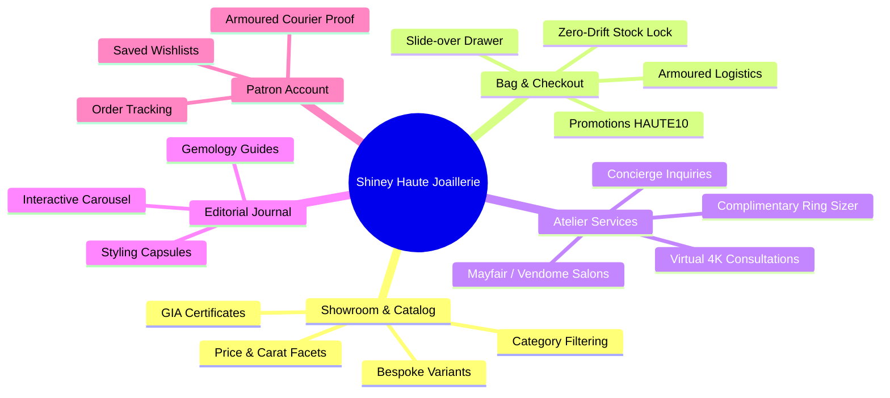
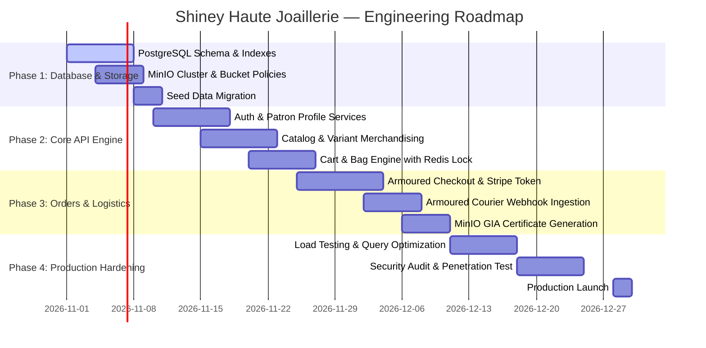

# Shiney Haute Joaillerie & Cinematic Storefront
## Product Requirements Document (PRD)

| Metadata | Specification |
|---|---|
| **Project Title** | Shiney Jewellery — Haute Joaillerie & Cinematic Storefront |
| **Document Version** | 2.0.0 (Frontend-to-Backend Full-Stack Specification) |
| **Status** | Approved & Architecture Ready |
| **Primary Databases** | PostgreSQL 16+ (Transactional RDBMS) & MinIO (S3-Compatible High-Res Media & Document Store) |
| **Target Frontend** | React 19, Vite 8, Tailwind CSS, GSAP, Lucide |
| **Target Backend** | Node.js / TypeScript (Express / Fastify / NestJS) + Docker Orchestration |

---

## 1. Executive Summary & Vision

Shiney Haute Joaillerie is an ultra-premium, cinematic digital atelier and e-commerce experience designed to rival high-luxury jewelers such as Cartier, Van Cleef & Arpels, and Tiffany & Co. 

The platform merges tactile editorial storytelling, conflict-free certified diamond provenance, bespoke salon consultations, and seamless shopping bags with an armored logistics and high-throughput backend.

### Key Objectives
1. **Unrivaled Aesthetic Quality**: Sub-second rendering of 8K diamond macro visuals, cinematic carousels, and atmospheric amber lighting without performance penalties.
2. **Absolute Transactional Integrity**: Zero stock overselling on bespoke 1-of-1 creations through PostgreSQL ACID row-level locking.
3. **Enterprise Media Pipeline**: Direct-to-MinIO uploads with automated transcoding to next-gen formats (WebP, AVIF) and private presigned URLs for GIA grading certificates.
4. **Armored Logistics & Signature Tracking**: Complete tracking integration with armored couriers (Brink's Global, FedEx Custom Critical) with signature verification upon delivery.

---

## 2. User Personas & Stakeholders

### Persona 1: Lady Victoria (The High-Net-Worth Collector)
- **Profile**: 38-55 years old, collects bespoke high jewelry, values ethical gold and GIA diamond certification.
- **Pain Point**: Skeptical of buying high-value jewelry online without certified provenance, private consultations, and armored delivery guarantees.
- **Platform Need**: Immersive 8K galleries, instant GIA certificate PDF downloads, private salon booking (London/Paris/NYC), and discreet white-glove courier dispatch.

### Persona 2: Liam (The Milestone Gift Giver)
- **Profile**: 28-40 years old, searching for an engagement ring or landmark anniversary creation.
- **Pain Point**: Anxious about ring sizing, metal choice, and shipment security.
- **Platform Need**: Intuitive ring size selector, complimentary ring sizer dispatch, gift packaging previews, and real-time order tracking.

### Persona 3: Master Goldsmith Julian & Concierge Elena (Atelier Staff)
- **Profile**: In-house gemologists and client relations managers.
- **Pain Point**: Needs clear inventory reservation status, client sizing notes, and scheduled consultation calendars.
- **Platform Need**: Robust back-office API to view appointment requests, update assembly stages, and upload digital gemological certificates to MinIO.

---

## 3. Comprehensive Functional Requirements Matrix



### Module 1: Homepage & Cinematic Storytelling (`/`)
- **Hero Carousel**: Auto-advancing 5-slide editorial showcase (4s interval) with gold gradient badges, background imagery, and direct shop links.
- **Interactive Arabesque Atelier Backdrop**: Atmospheric golden lantern flicker animations with gem emblem halo and atelier story callout.
- **Trending Products of the Week**: Interactive grid/carousel with Quick View modal, Wishlist toggling, and comparison actions.
- **Our Latest Blog Carousel**: 8 curated editorial articles with smooth slide transform, left/right navigation arrows, and pagination indicator dots.
- **Infinite Marquee Ticker**: Continuous ticker displaying complimentary delivery and iconic collection assurances.

### Module 2: Catalog & Showroom Filtering (`/shop`)
- **Search & Filter Engine**: Real-time multi-facet filtering by category (`rings`, `necklaces`, `earrings`, `bangles`, `bridal`), carat purity (`10KT` to `24KT`), and price range.
- **View Modes**: Instant toggle between Grid and List merchandising view.
- **Active Filter Chips**: Dynamic pill tags allowing single or bulk clear.

### Module 3: Product Detail Page & Variants (`/product/:slug`)
- **Multi-Angle Gallery**: Vertical thumbnail selector with smooth main stage zoom.
- **Variant Selector**: Dynamic ring sizes (Size 5 to 8) with real-time stock status and waitlist indicators.
- **Express Checkout Actions**: "Add to Bag" (slides open drawer) and "Buy It Now" (direct router navigation to checkout).
- **Provenance Assurances**: Conflict-free diamonds, certified recycled 18k solid gold, complimentary ultrasonic cleaning, and 30-day exchange guarantees.

### Module 4: Shopping Bag Drawer & Promos (`/cart`)
- **Slide-over Drawer & Full Page**: Persistent cart state with live quantity modification and item deletion.
- **Complimentary Shipping Progress Bar**: Dynamic threshold calculator ($250 target) with visual fill meter.
- **Salon Privilege Promotions**: Validates promotional codes (`HAUTE10`, `SHINEYVIP`) against order subtotal.

### Module 5: Armoured Insured Checkout (`/checkout`)
- **3-Step Stepper Flow**: Step 1 (Shipping Information), Step 2 (Courier & Payment Method), Step 3 (Order Confirmation).
- **Courier Selection**: Armored Insured Standard (Complimentary over $250) vs Priority Overnight Armored Escort ($45).
- **Prototype Demonstration Notice**: Explicit security banner confirming demonstration mode for test cards.
- **Order Generation**: Generates unique luxury order reference (e.g. `SH-2026-94812`).

### Module 6: Patron Account & Order History (`/account`)
- **Dual Login/Register**: Seamless patronage authentication with password masking toggle.
- **Order Dashboard**: Detailed order cards showing assembly status (`In Handcrafted Atelier Assembly`), line items, and courier tracking numbers (`BRK-89210-US`).
- **Wishlist Management**: Synchronized saved creations with one-click transfer to shopping bag.

### Module 7: Atelier Salon Appointments & Concierge (`/contact`)
- **Salon Reservation**: Appointment booking for London Mayfair, Paris Place Vendôme, or New York Madison Avenue.
- **Virtual 4K Gemology Sessions**: High-definition video appointment scheduling.
- **Complimentary Ring Sizer Form**: Postal address request form for physical metal ring sizers.

### Module 8: Editorial Journal (`/blog` and `/blog/:slug`)
- **8 Curated Articles**: Rich typography, reading times, gemologist author bios, and related articles.
- **Category Filter Tabs**: Quick filtering across Earrings, Diamonds, Gifts Set, and Pearls.

---

## 4. Backend System & RESTful API Specifications

Base URL: `https://api.shiney.com/v1`

### 4.1 Authentication & Patron Endpoints

| Method | Endpoint | Description | Auth Required |
|---|---|---|---|
| `POST` | `/auth/register` | Register new patron account | No |
| `POST` | `/auth/login` | Authenticate with email/password; returns JWT | No |
| `POST` | `/auth/refresh` | Refresh expired access token via HTTP-only cookie | Yes (Cookie) |
| `POST` | `/auth/logout` | Revoke active refresh token | Yes |
| `GET` | `/patron/profile` | Retrieve patron details, tier, and saved addresses | Yes |
| `PUT` | `/patron/profile` | Update profile preferences and sizing | Yes |

#### Sample Response: `POST /auth/login`
```json
{
  "success": true,
  "patron": {
    "id": "u0000000-0000-0000-0000-000000000001",
    "name": "Lady Eleanor Vance",
    "email": "eleanor@vance-atelier.com",
    "tier": "Gold Atelier Patron",
    "patronNumber": "PAT-2026-8912"
  },
  "accessToken": "eyJhbGciOiJSUzI1NiIsIn...",
  "expiresIn": 900
}
```

### 4.2 Catalog & Merchandising Endpoints

| Method | Endpoint | Description | Auth Required |
|---|---|---|---|
| `GET` | `/categories` | List all jewelry categories with active counts | No |
| `GET` | `/products` | Filtered list with pagination, carats, price, sorting | No |
| `GET` | `/products/:slug` | Retrieve complete product, variants, images, and certs | No |
| `GET` | `/products/trending` | Top 6 weekly trending creations | No |
| `GET` | `/products/bestsellers`| Curated bestseller collection | No |

#### Query Parameters: `GET /products`
- `category` (string, optional): e.g. `rings`, `necklaces`
- `minPrice` (numeric, optional): e.g. `500`
- `maxPrice` (numeric, optional): e.g. `5000`
- `goldCarat` (string, optional): e.g. `18KT`, `24KT`
- `sort` (enum): `featured`, `price_asc`, `price_desc`, `rating`, `newest`
- `page` (int, default: 1), `limit` (int, default: 12)

### 4.3 Shopping Bag & Checkout Endpoints

| Method | Endpoint | Description | Auth Required |
|---|---|---|---|
| `GET` | `/cart` | Retrieve current cart items and calculated subtotal | Optional (Session ID) |
| `POST` | `/cart/items` | Add product variant to bag | Optional (Session ID) |
| `PATCH`| `/cart/items/:id`| Update item quantity | Optional (Session ID) |
| `DELETE`| `/cart/items/:id`| Remove line item from bag | Optional (Session ID) |
| `POST` | `/cart/apply-promo`| Validate promo code (`HAUTE10`, `SHINEYVIP`) | Optional (Session ID) |
| `POST` | `/orders/checkout`| Atomically reserve stock and create order | Optional (Guest/User) |
| `GET` | `/orders/:orderNumber`| Retrieve order status and tracking details | Yes (or Order Token) |

### 4.4 MinIO Object Storage & Media Endpoints

| Method | Endpoint | Description | Auth Required |
|---|---|---|---|
| `POST` | `/media/presigned-upload`| Request signed S3 PUT URL for direct MinIO upload | Admin / Staff |
| `GET` | `/media/certificate/:id` | Generate short-lived presigned GET URL for GIA PDF | Authenticated Patron |
| `POST` | `/media/user-sketch` | Upload custom engraving sketch | Optional |

---

## 5. Non-Functional Requirements (NFR)

1. **Performance & Speed**:
   - Time to First Byte (TTFB) < 80ms at Cloudflare Edge.
   - P99 Product Details Page load < 350ms.
   - Database read query response times < 25ms.
2. **Reliability & Availability**:
   - 99.99% system availability SLA.
   - Dual-zone PostgreSQL replication with automated failover via Patroni / PgBouncer.
   - MinIO Erasure Coding (EC:4) withstanding up to 2 disk failures per cluster.
3. **Security & Data Privacy**:
   - Strict Content Security Policy (CSP), TLS 1.3, and CORS restrictions.
   - Full GDPR & CCPA patron data export and deletion endpoints.
   - Salted password hashing via Argon2id (memory: 64MB, iterations: 3).
4. **Data Retention & Backups**:
   - Continuous PostgreSQL Write-Ahead Log (WAL) archiving to `shiney-backups` MinIO bucket.
   - Recovery Point Objective (RPO) < 5 minutes; Recovery Time Objective (RTO) < 30 minutes.

---

## 6. Implementation Roadmap & Milestones


